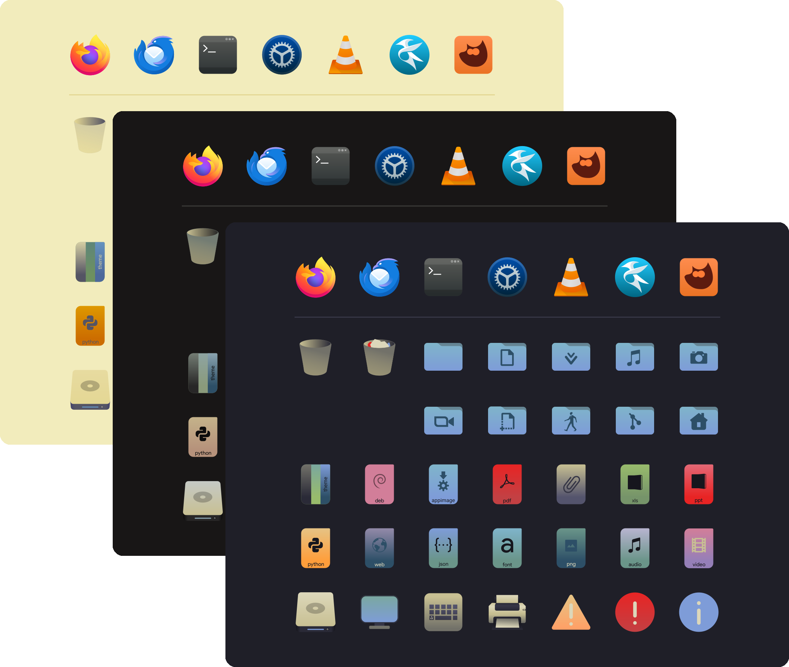
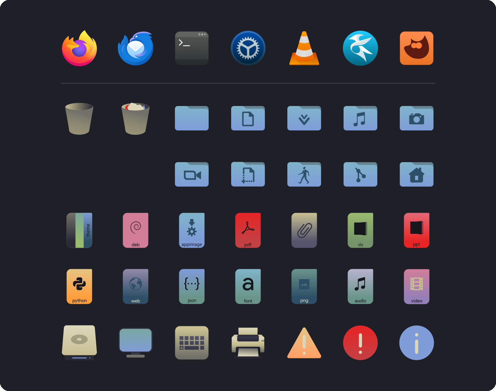
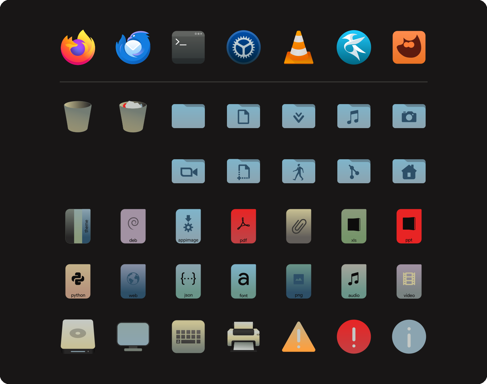
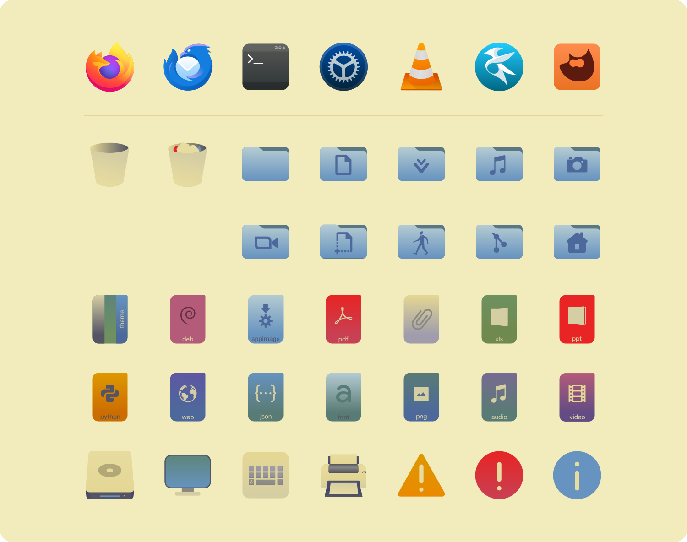

<h3>Kanagawa icons</h3>
<p>A community-maintained theme inspired by Hokusai's <em>The Great Wave off Kanagawa</em>.</p>
<p>Using the <a href="https://github.com/rebelot/kanagawa.nvim">Kanagawa palette</a> by <a href="https://github.com/rebelot">Tommaso Laurenzi (rebelot)</a>.</p>
<p>Based on the <a href="https://github.com/bikass/kora">Kora icon theme</a> by <a href="https://github.com/bikass">bikass</a>.</p>

<!-- Wave accents: carpYellow, crystalBlue, autumnRed. Lotus accents: lotusYellow, lotusBlue4, lotusRed. -->
<p>
  <a href="https://github.com/kanagawa-community/icons/stargazers">
    <picture>
      <source media="(prefers-color-scheme: dark)" srcset="https://img.shields.io/github/stars/kanagawa-community/icons?style=for-the-badge&amp;labelColor=1F1F28&amp;color=E6C384">
      <source media="(prefers-color-scheme: light)" srcset="https://img.shields.io/github/stars/kanagawa-community/icons?style=for-the-badge&amp;labelColor=F2ECBC&amp;color=77713F">
      
    </picture>
  </a>
  <a href="https://github.com/kanagawa-community/icons/releases/latest">
    <picture>
      <source media="(prefers-color-scheme: dark)" srcset="https://img.shields.io/github/v/release/kanagawa-community/icons?style=for-the-badge&amp;label=release&amp;labelColor=1F1F28&amp;color=7E9CD8">
      <source media="(prefers-color-scheme: light)" srcset="https://img.shields.io/github/v/release/kanagawa-community/icons?style=for-the-badge&amp;label=release&amp;labelColor=F2ECBC&amp;color=4D699B">
      
    </picture>
  </a>
  <a href="https://github.com/kanagawa-community/icons/issues">
    <picture>
      <source media="(prefers-color-scheme: dark)" srcset="https://img.shields.io/github/issues/kanagawa-community/icons?style=for-the-badge&amp;labelColor=1F1F28&amp;color=C34043">
      <source media="(prefers-color-scheme: light)" srcset="https://img.shields.io/github/issues/kanagawa-community/icons?style=for-the-badge&amp;labelColor=F2ECBC&amp;color=C84053">
      
    </picture>
  </a>
</p>

<br clear="both">
<br>

## Previews



<details>
<summary>🌊 Wave</summary>

</details>

<details>
<summary>🐉 Dragon</summary>

</details>

<details>
<summary>🪷 Lotus</summary>

</details>

## Requirements

- Any desktop that reads freedesktop icon themes: KDE Plasma, GNOME, Xfce and others.
- Breeze icons, for the few icons Kora does not draw (as with Kora itself).

## Installation

Clone the repository and copy the theme into `~/.local/share/icons`:

```sh
git clone https://github.com/kanagawa-community/icons
mkdir -p ~/.local/share/icons
cp -r icons/themes/Kanagawa-Kora-Wave ~/.local/share/icons/
```

For Dragon or Lotus, copy `Kanagawa-Kora-Dragon` or `Kanagawa-Kora-Lotus` instead.

The theme ships without an icon cache. GTK applications load icons faster with one:

```sh
gtk-update-icon-cache -f ~/.local/share/icons/Kanagawa-Kora-Wave
```

## Usage

In KDE Plasma, pick **Kanagawa Kora Wave** in **System Settings > Colors & Themes >
Icons**. On GNOME, run `gsettings set org.gnome.desktop.interface icon-theme
Kanagawa-Kora-Wave`.

## Palette

Every color in the icons is replaced by a role from the shared
[palette](https://github.com/kanagawa-community/.github/blob/main/docs/PALETTE.md), so
each variant uses its own value for the same role. Kora has well over a thousand colors,
mostly gradient shades, so they are not mapped one by one: each color is sorted into a
hue family, and its lightness picks one of that family's roles.

| Kora colors                        | Palette roles                                                          |
| ---------------------------------- | ---------------------------------------------------------------------- |
| Greys and whites                   | `ui.bg_m3` to `ui.fg` (not `ui.bg`), by lightness                      |
| Blues (folders)                    | `ui.bg_search`, `syn.fun`, `term.bright_blue`; folder back `diag.info` |
| Reds                               | `vcs.removed`, `diag.error`, `syn.preproc`, `syn.special3`             |
| Oranges                            | `syn.constant`, `diag.warning`                                         |
| Yellows                            | `vcs.changed`, `syn.operator`, `syn.identifier`                        |
| Greens                             | `vcs.added`, `syn.string`                                              |
| Cyans                              | `diag.hint`, `syn.type`                                                |
| Purples                            | `syn.statement`, `ui.special`, `syn.parameter`                         |
| Pinks                              | `syn.number`                                                           |
| Labels and symbols on file types   | `ui.bg_m3` or `ui.fg`, whichever stands out from the icon              |
| Symbolic icon text                 | `ui.fg`                                                                |
| Symbolic icon highlight            | `syn.fun`                                                              |
| Symbolic positive/neutral/negative | `diag.ok`, `diag.warning`, `diag.error`                                |

In KDE Plasma, symbolic icons follow the active color scheme, as they do in Kora. The
application icons (`apps/`) are brand logos and keep their own colors.
`scripts/generate.py` holds the full rules.

## Issues and contributions

Report bugs and request changes in this port's
[issue tracker](https://github.com/kanagawa-community/icons/issues). Contributions are welcome.

See [CONTRIBUTING.md](CONTRIBUTING.md) before opening a pull request.

## License

GPL-3.0, like Kora. See [LICENSE](LICENSE). Each theme in `themes/` carries a copy of
the license, since it is installed on its own.

The icons in `src/` are the [Kora icon theme](https://github.com/bikass/kora) by bikass
(GPL-3.0), unchanged from commit
[`e63a9e1`](https://github.com/bikass/kora/tree/e63a9e1b4f3b1f647b4cf9c64c1ece58ce45f75a).

Kanagawa Community contributors modified this work in November 2026 and later: the themes
in `themes/` are the icons in `src/` with their colors replaced by `scripts/generate.py`.
Git history records every change. The application icons in `apps/` are Kora's,
unchanged; the logos they show are trademarks of their owners.
